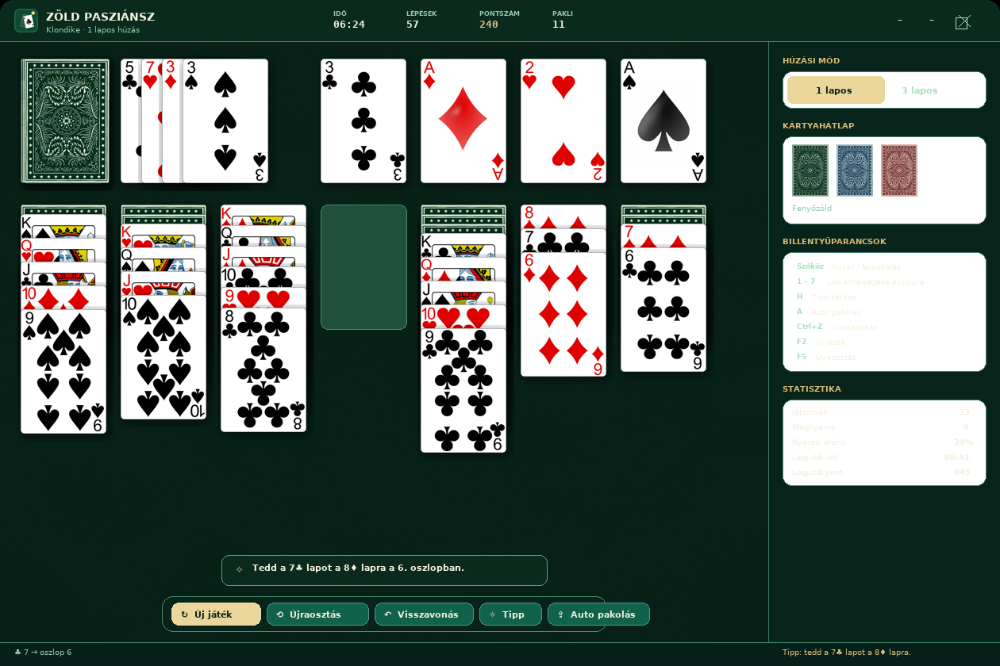

# Zöld Pasziánsz

Klasszikus **Klondike pasziánsz** C# / WPF nyelven, teljesen egyedi, zöld témájú felülettel.



## Jellemzők

- **Klondike szabályok** – 7 oszlop, 4 gyűjtőhely, húzópakli és talon.
- **1 lapos és 3 lapos húzás** – a játék közben is váltható (a váltás új osztást indít).
- **Egyedi, keret nélküli ablak** – saját címkesáv, lekerekített sarkok, vetett árnyék, zöld gradiens és filc textúra.
- **Kártyák resource-ként** – az 52 lap és a három kártyahátlap PNG-ként beépül a binárisba, és `ResourceDictionary`-ből (`Resources/Cards.xaml`) érkezik, nem fájlrendszerről.
- **Három választható kártyahátlap** – fenyőzöld (alapértelmezett), tengerkék, bordóvörös – a zöld árnyalataihoz igazítva.
- **Kétféle mozgatás** – kattintás + célrakásra kattintás, vagy egérrel való húzás; dupla kattintás = felpakolás a gyűjtőhelyre.
- **Visszavonás** korlátlanul (lépésenként), **tipp**, **automatikus felpakolás**, **újraosztás** ugyanazzal a paklival.
- **Pontozás** a klasszikus Klondike szabály szerint, valamint statisztika (játszmák, nyerési arány, legjobb idő és pontszám).
- **Animált lapmozgás**, hangeffektusok (generált, külső fájl nélkül), lebegő hibaüzenetek.
- **Mentett beállítások** és statisztika: `%APPDATA%\ZoldPasziansz\`.

## Követelmények

- Windows 10 vagy 11
- [.NET 8 SDK](https://dotnet.microsoft.com/download/dotnet/8.0) (vagy újabb) – a projekt `net8.0-windows` célkeretrendszert használ
- Visual Studio 2022 (17.8+) *vagy* a .NET CLI

## Futtatás

```powershell
# a repó gyökerében
dotnet run --project Pasziansz/Pasziansz.csproj
```

Vagy nyisd meg a `Pasziansz.sln` fájlt Visual Studióban, és indítsd el az **F5** billentyűvel.

Kiadási build:

```powershell
dotnet publish Pasziansz/Pasziansz.csproj -c Release -r win-x64 --self-contained false
```

## Irányítás

| Művelet | Lehetőség |
| --- | --- |
| Húzás a pakliból | kattintás a húzópaklira, `Szóköz` vagy `Enter` |
| Lap kiválasztása / mozgatása | kattintás a lapra, majd a célrakásra; vagy egérrel húzás |
| Felpakolás a gyűjtőhelyre | dupla kattintás a lapra, vagy `Szóköz` kijelölt lap esetén |
| Áthelyezés oszlopra | `1`–`7` billentyű kijelölt lap esetén |
| Tipp | `H` |
| Automatikus felpakolás | `A` |
| Visszavonás | `Ctrl+Z` |
| Új osztás | `F2` |
| Ugyanazon osztás újrajátszása | `F5` |
| Játékszabály | `F1` |
| Kilépés | `Alt+F4` vagy a bezárás gomb |

## Szabályok röviden

A négy gyűjtőhelyre (♣ ♦ ♥ ♠) színenként ásztól királyig kell felpakolni mind az 52 lapot.
Az oszlopokra csak **váltakozó színnel** és **eggyel kisebb értékkel** kerülhet lap, üres oszlopra pedig csak **király**.
A lefordított lapok alól a felette lévő lapok elmozgatásával szabadulnak fel a lapok.

Pontozás: +10 gyűjtőhelyre tett lap, +5 talonból oszlopra tett lap, +15 felfordítás,
−15 gyűjtőhelyről visszavett lap, −20 talon újrakeverése, −100 a pakliba visszatett talonlap.

## Projekt felépítése

```
Pasziansz.sln
Pasziansz/
├─ App.xaml / App.xaml.cs          – alkalmazás, témabetöltés, hibakezelés
├─ MainWindow.xaml(.cs)            – egyedi ablak, játéktér, oldalsáv, állapotsáv
├─ Assets/
│  ├─ Cards/                       – 52 kártyalap (a cards mappából előkészítve)
│  ├─ Backs/                       – három kártyahátlap
│  ├─ Textures/                    – filc textúra, ikon
│  └─ App.ico
├─ Resources/
│  ├─ Cards.xaml                   – a kártyák ResourceDictionary-je (Card.<szín>.<érték>)
│  ├─ Theme.xaml                   – zöld színpaletta és ecsetek
│  └─ Styles.xaml                  – gombok, kapcsolók, csúszka, tippek stílusai
├─ Controls/
│  ├─ CardTableView.cs             – a kártyaasztal (elrendezés, drag & drop, animációk)
│  ├─ CardView.xaml(.cs)           – egy kártya megjelenítése
│  ├─ CardBackPreview.xaml(.cs)    – hátlap-előnézet a beállításokhoz
│  └─ ToastHost.xaml(.cs)          – lebegő üzenetek
├─ Game/
│  ├─ KlondikeGame.cs              – a játék teljes logikája (osztás, lépések, undo, tipp)
│  ├─ Rules.cs                     – a Klondike szabályai
│  ├─ Scoring.cs                   – pontozás
│  ├─ Statistics.cs                – statisztika mentése/betöltése
│  └─ PileLocation.cs              – a rakások modellje a nézethez
├─ Models/                         – Card, Deck, Pile, MoveRecord
├─ Services/                       – Settings, ThemeManager, SoundPlayer
└─ Dialogs/                        – WinDialog, RulesDialog
```

## Megjegyzés a kártyákról

A `cards/` mappában található eredeti képekből készültek a játék erőforrásai:

- a 52 kártyalap egységes **300×436** px méretre és **lekerekített sarkú, átlátszó** hátterű PNG-vé alakítva (`Pasziansz/Assets/Cards/`);
- a három kártyahátlap az eredeti fekete/kék/piros grafikából **zöld, tengerkék és bordó** színvilágra átszínezve, a lapokkal azonos méretben és lekerekítéssel (`Pasziansz/Assets/Backs/`).

Ezek a képek `Resource` elemekként a `.csproj`-ban bekerülnek a binárisba, a játék pedig
`pack://application:,,,/Assets/...` URI-kkel, `Resources/Cards.xaml`-ből éri el őket.
